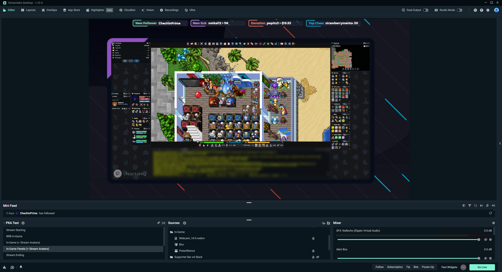

# NoctaPrivacy — desfoque de privacidade para lives no Streamlabs Desktop



O NoctaPrivacy é um projeto experimental, de código-fonte aberto para análise, criado para proteger informações pessoais durante transmissões ao vivo, como conversas no chat do jogo e outras informações exibidas na janela transmitida.

A ideia é simples: manter uma camada visual de desfoque pronta para ser exibida ou ocultada diretamente no Streamlabs, sem trocar de cena nem alterar a captura original do jogo.

> **Aviso sobre o PokeAlliance:** o suporte informou em 12/11/2026 que softwares de terceiros para essa finalidade são proibidos e podem resultar em punição. **Este repositório não representa autorização de uso. Não utilize a ferramenta com PokeAlliance sem uma liberação explícita da equipe.** O código está disponível para permitir uma avaliação técnica transparente.

## Como funciona

`Janela selecionada → Windows.Graphics.Capture → Direct3D 11 (desfoque na GPU) → Spout2 → Streamlabs Desktop`

- O programa localiza a janela pelo título e obtém seu identificador (`HWND`) usando APIs comuns do Windows.
- Solicita ao próprio Windows os quadros visuais dessa janela por meio de `Windows.Graphics.Capture`.
- Aplica um efeito de desfoque em duas passagens usando shaders Direct3D 11.
- Envia o resultado ao Streamlabs por uma fonte `Spout2 Capture`, sem transmitir o vídeo para servidores externos.
- No Streamlabs, essa fonte fica acima da captura original. O usuário mostra ou oculta **a camada inteira** com o ícone de visibilidade ou um atalho. O desfoque permanece ativo na saída do programa.

O projeto não instala um filtro dentro do processo do jogo, não modifica arquivos do cliente e não precisa duplicar a cena do Streamlabs. O efeito cobre a área capturada e alinhada na transmissão — não desfoca automaticamente todas as aplicações do computador.

## Interação com o cliente do jogo

Esta é a distinção mais importante para a análise:

| Operação | NoctaPrivacy |
| --- | --- |
| Identifica a janela, consulta seu título e utiliza o `HWND` | **Sim** |
| Captura a imagem da janela pela API de captura do Windows | **Sim** |
| Abre o processo do jogo com `OpenProcess` | Não |
| Lê ou escreve a memória privada com `ReadProcessMemory` / `WriteProcessMemory` | Não |
| Injeta DLLs, instala hooks no jogo ou executa código dentro do cliente | Não |
| Envia comandos, simula ações ou automatiza a jogabilidade | Não |
| Intercepta tráfego de rede ou se conecta aos servidores do jogo | Não |

Essas afirmações descrevem **o código-fonte disponível neste repositório**, não uma certificação de segurança ou de compatibilidade com anticheat. O programa **interage com a janela por APIs do Windows**, mesmo sem abrir ou modificar a memória do processo. A escolha de usar uma API oficial de captura **não garante** que o uso seja permitido pelas regras do PokeAlliance.

Arquivos principais para revisão:

- [`src/main.cpp`](src/main.cpp) — identificação da janela, captura, processamento gráfico e envio por Spout2.
- [`CMakeLists.txt`](CMakeLists.txt) — configuração de compilação e bibliotecas.
- [`build.ps1`](build.ps1) — script que baixa a dependência Spout2 durante a compilação.
- [`.github/workflows/windows-build.yml`](.github/workflows/windows-build.yml) — compilação automatizada em Windows x64.

## Comportamento no Streamlabs

1. A fonte original do jogo permanece na cena, sem alterações.
2. Uma fonte `Spout2 Capture` chamada `NoctaPrivacy` é posicionada acima dela e alinhada à mesma região.
3. Com a fonte Spout2 **oculta**, a transmissão exibe a imagem normal.
4. Com a fonte Spout2 **visível**, a transmissão exibe a mesma região desfocada.

Os controles do executável são `Ctrl+Alt+F11` (tela preta) e `Ctrl+Alt+F12` (encerrar). O atalho para mostrar ou ocultar a fonte pode ser configurado **no próprio Streamlabs**; o executável não alterna o desfoque.

## Estado e limitações

- **Protótipo beta:** compilado com sucesso pelo GitHub Actions, mas sem validação completa de funcionamento, desempenho ou compatibilidade com o anticheat do PokeAlliance.
- O desfoque não é proteção suficiente para senhas ou outros dados altamente sensíveis. Para isso, é preferível uma camada **totalmente opaca** no Streamlabs.
- Se o aplicativo ou a conexão Spout2 falhar, a imagem original que está abaixo da camada poderá voltar a aparecer.
- A captura de janela pode falhar com tela cheia exclusiva, janelas minimizadas, conteúdo protegido ou restrições de captura.
- Nenhuma rotina de captura deve ser considerada permitida apenas por ser semelhante à usada por softwares de transmissão.

## Compilação para análise e testes autorizados

Requisitos: Windows x64, Visual Studio 2022 com C++ e SDK do Windows, CMake e Git. Alternativamente, o workflow **Build NoctaPrivacy (Windows x64)** permite compilar no GitHub Actions e obter o executável em **Artifacts**.

Compilação local:

```powershell
.\build.ps1
```

O executável fica em `build\Release\NoctaPrivacy.exe`.

Para testes com uma janela **não relacionada ao PokeAlliance**, a aplicação recebe parte do título da janela como argumento:

```powershell
.\build\Release\NoctaPrivacy.exe "Nome da janela de teste"
```

A biblioteca [Spout2](https://github.com/leadedge/Spout2) é baixada de seu repositório oficial na etapa de compilação (tag `2.007.017`). Durante a execução, o vídeo é processado localmente e compartilhado com o Streamlabs na mesma máquina.

## Solicitação de avaliação à equipe PokeAlliance

O propósito deste repositório é apresentar **exatamente o que o programa faz**, para que a equipe possa avaliar se a captura de janela por `Windows.Graphics.Capture` e o uso como fonte visual no Streamlabs são compatíveis com as regras do servidor.

Se esse método for proibido, a decisão será respeitada. O objetivo não é contornar o anticheat, mas encontrar uma forma autorizada de proteger a privacidade nas transmissões.

Referência técnica: [Windows.Graphics.Capture — documentação Microsoft](https://learn.microsoft.com/en-us/windows/apps/develop/media-authoring-processing/screen-capture).
